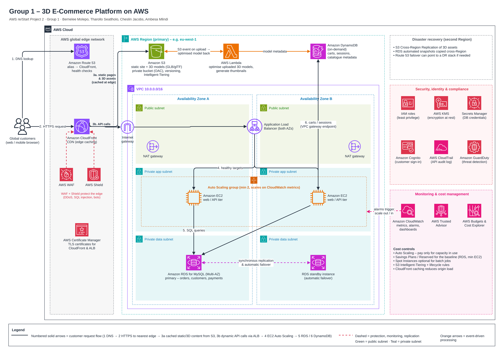

# 3D E-Commerce Platform Architecture on AWS

**AWS re/Start Project 2 · Group 1 · October 2026**
**Designed and documented by:** Cheslin Jacobs, for the Group 1 submission (with Bernelee Molepo, Tharollo Seatlholo and Ambesa Mlindi)

*Numbered arrows show the customer request flow. [Open the full-size diagram](images/3d-ecommerce-architecture.png).*

---

## The problem

A startup wants to sell furniture, gadgets and fashion online, and let customers rotate, zoom and inspect a 3D model of each product before they buy. It expects millions of users around the world. The platform had to be **fast, highly available, scalable, secure and cost-efficient**.

The key insight that shaped the design: the 3D rendering happens **in the customer's browser (WebGL)**. The cloud's job is not to render anything. It is to deliver large 3D files (GLB/glTF and textures) and shop data quickly and reliably, everywhere.

## The architecture

One primary AWS Region across **two Availability Zones**, with Amazon CloudFront delivering the website and 3D files from edge locations close to users.

| Service | Why we chose it |
|---|---|
| **Amazon Route 53** | Managed DNS. An alias record points to CloudFront; health checks and failover routing can redirect traffic if an endpoint fails. |
| **Amazon CloudFront** | Global CDN that caches the site and the large 3D files at the edge, so models load quickly worldwide and the origin does less work. |
| **AWS WAF & AWS Shield** | WAF filters SQL injection, cross-site scripting and bad bots; Shield Standard gives free DDoS protection on CloudFront and Route 53. |
| **Amazon S3** | Durable, low-cost storage for 3D models, images and the static front end. The bucket is private; only CloudFront can read it (Origin Access Control). |
| **Application Load Balancer** | Spreads API traffic across healthy EC2 instances in both AZs and stops routing to failed ones. |
| **Amazon EC2 + Auto Scaling** | Runs the web/API tier (product pages, search, checkout) and adds or removes instances to match demand. |
| **AWS Lambda** | Triggered when a new 3D model is uploaded to S3: compresses and optimises the model and creates thumbnails. Pay per use, no idle servers. |
| **Amazon RDS for MySQL (Multi-AZ)** | Orders, customers and payment records, which need transactions and joins. AWS handles backups, patching and failover. |
| **Amazon DynamoDB (on-demand)** | Millisecond look-ups for carts, sessions and catalogue metadata; scales automatically. |
| **IAM, KMS, Secrets Manager, ACM, Cognito** | Least-privilege access, encryption keys, stored database credentials, TLS certificates and customer sign-in. |
| **CloudTrail & GuardDuty** | Audit log of every API call, and threat detection on the account. |
| **Amazon CloudWatch** | Metrics, logs, alarms and dashboards; alarms drive Auto Scaling and alert the team. |
| **Trusted Advisor, Budgets, Cost Explorer** | Cost, security and limit checks, plus spending alerts. |

## How the pieces fit together

Following the numbered arrows on the diagram:

1. **Route 53** resolves the domain to CloudFront.
2. The customer connects over HTTPS to the nearest **CloudFront** edge location, protected by **WAF + Shield**.
3. a) Static pages and 3D models come from the **private S3 bucket** and are cached at the edge.
   b) API calls (search, cart, checkout) go through the internet gateway to the **Application Load Balancer**.
4. The ALB sends requests to healthy **EC2 instances** in an Auto Scaling group across two AZs (private subnets).
5. Orders, customers and payments are stored in **RDS MySQL Multi-AZ**.
6. Carts, sessions and catalogue data are stored in **DynamoDB** (reached through a VPC gateway endpoint).

**Side flow:** when a new model is uploaded to S3, an S3 event triggers **Lambda**, which optimises it, makes thumbnails and writes the metadata to DynamoDB.

## High availability and scaling

- Every tier runs in **two AZs**: the ALB, at least two EC2 instances (one per AZ), a NAT gateway per AZ, and an RDS standby with automatic failover.
- S3, DynamoDB, Lambda and CloudFront are managed services that are multi-AZ or global by design. Automated RDS backups and S3 versioning add protection.
- **Traffic spikes:** CloudFront serves most requests from cache, so the back end sees far less load. Auto Scaling target tracking (e.g. 60% average CPU) scales out during a sale and back in afterwards. Lambda runs in parallel when many models are uploaded, DynamoDB on-demand absorbs bursts, and an RDS read replica can be added for read-heavy queries.
- **Performance:** compressed, optimised 3D files (smaller GLBs and lower-detail previews) served over HTTP/2 and HTTP/3; ElastiCache could be added later for popular queries.
- **Disaster recovery:** S3 Cross-Region Replication and cross-Region RDS snapshot copies, with Route 53 able to point to a DR stack.

## Security

Shared responsibility model and defence in depth:

- **Edge:** WAF, Shield and HTTPS with ACM certificates.
- **Network:** EC2 and RDS in private subnets with no public IPs; security groups chained ALB → app → database; network ACLs as a second layer. S3 Block Public Access on, with only CloudFront allowed to read the bucket.
- **Identity:** IAM roles (not access keys) for EC2 and Lambda with least privilege; MFA for administrators; Cognito for customer sign-up and sign-in.
- **Data:** encrypted at rest with KMS (S3, RDS, DynamoDB, EBS) and in transit with TLS; database passwords in Secrets Manager.
- **Detection:** CloudTrail for auditing, GuardDuty for threats.
- **Compliance:** card payments through a PCI DSS-compliant payment provider, and customer data handled in line with POPIA.

## Cost

- Pay for what you use: Auto Scaling removes instances when it's quiet; Lambda and DynamoDB on-demand bill per request.
- CloudFront caching cuts EC2 load and data-transfer cost.
- S3 Intelligent-Tiering and lifecycle rules move rarely viewed models and old versions to cheaper storage.
- Savings Plans or Reserved Instances for the steady baseline (minimum EC2 and RDS); Spot for non-urgent batch jobs.
- VPC gateway endpoints for S3 and DynamoDB avoid NAT data charges.
- CloudWatch for right-sizing, Trusted Advisor for idle resources, AWS Budgets for alerts before spend goes over plan.

## Trade-offs we accepted

- **One Region vs multi-Region:** multi-AZ in one Region is far cheaper and simpler. CloudFront hides most of the distance for static and 3D content, but API calls from far-away users still travel to one Region, and recovery from a full Region outage would take hours, not minutes.
- **EC2 vs serverless:** EC2 gives control and is familiar, but needs patching.
- **Two databases:** the right tool for each job, at the cost of more complexity.
- **Large 3D files:** data transfer out is a major cost and slow mobile networks are a challenge, so the optimisation pipeline and caching are essential. Versioned file names avoid frequent CloudFront invalidations.
- **Cost of availability:** Multi-AZ RDS roughly doubles database cost and two NAT gateways add hourly charges; we accepted this for 24/7 uptime.

## My role

I designed the full architecture, drew the diagram, and wrote the architecture explanation and the talking points for our group submission.

## Group credit

This was submitted as AWS re/Start Group 1 work, alongside Bernelee Molepo, Tharollo Seatlholo and Ambesa Mlindi. Thanks to them for being part of the group.

## What I'd do differently

- **Move the API off EC2:** run it on Amazon ECS with Fargate, or Lambda behind API Gateway, to remove patching and idle capacity.
- **Warmer disaster recovery:** a pilot-light or warm-standby stack in the second Region (for example Aurora Global Database or DynamoDB global tables) if the business needs recovery in minutes rather than hours.
- **Add ElastiCache** in front of the catalogue and search queries once traffic justifies it.
- **Infrastructure as code:** define the whole stack in CloudFormation so it can be deployed, reviewed and torn down repeatably.
- **Build a small proof of concept** of the S3 → Lambda model-optimisation pipeline to measure real file-size and load-time savings.
